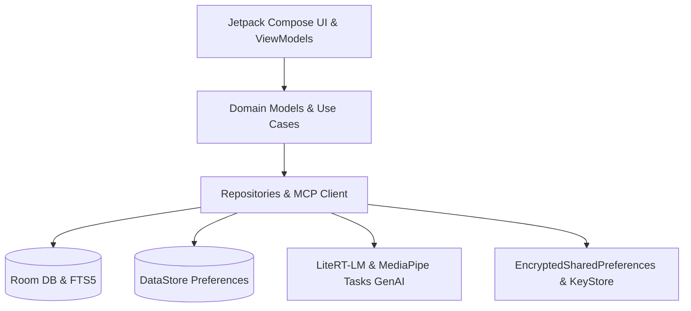

<div align="center">

# WHISK
### *The Ultimate Local-First Developer Knowledge Workspace & AI-Augmented IDE for Android*

[](https://kotlinlang.org)
[](https://developer.android.com/jetpack/compose)
[](https://developer.android.com)
[](https://ai.google.dev)
[](https://github.com/whisk/whisk/blob/main/LICENSE)

<p align="center">
  <b>Whisk</b> is a high-performance, offline-first personal knowledge management (PKM) system and developer suite built natively for Android in Kotlin and Jetpack Compose. It bridges the gap between mobile computing and desktop-class developer tooling by integrating bidirectional linking, interactive 2D knowledge graphs, infinite spatial canvases, an MCP JSON-RPC client, and zero-latency on-device AI inference via LiteRT-LM & MediaPipe.
</p>

</div>

---

## Table of Contents

- [Core Capabilities](#core-capabilities)
- [On-Device AI & Hybrid LLM Workspace](#on-device-ai--hybrid-llm-workspace)
- [GitHub Explorer & Model Context Protocol (MCP) Client](#github-explorer--model-context-protocol-mcp-client)
- [Data Security & Vault Portability](#data-security--vault-portability)
- [Architecture & Tech Stack](#architecture--tech-stack)
- [Quick Start & Build](#quick-start--build)
- [Design System & Philosophy](#design-system--philosophy)
- [License](#license)

---

## Core Capabilities

### Advanced Markdown & Code Studio
- **Dual-Mode Editor**: Seamlessly toggle between distraction-free raw Markdown and live formatted preview.
- **Syntax-Aware Code Blocks**: Dedicated code blocks with language labels, copy actions, line numbers, and preserved indentation for Kotlin, Java, Python, Rust, Go, SQL, Bash, and JSON.
- **Backlinks & Resolution**: Automatic incoming/outgoing relationship discovery and broken-link detection.
- **Autosave**: Robust background persistence ensuring zero data loss.

### Interactive 2D Knowledge Graph
- **Global & Local Views**: Explore your entire vault graph or center focus around a specific note node.
- **Fluid Gestures**: Interactive pan, pinch-to-zoom, and smooth node selection.
- **Smart Classification**: Clear visual distinction between Notes, Tags, and Folders.
- **Orphan Finder**: Instantly isolate unlinked notes in your vault.

### Infinite Spatial Canvas
- **Visual Thinking**: Separate from linear markdown—freely arrange idea cards, notes, and containers on an infinite 2D coordinate plane.
- **Vector Connections**: Draw direct connection lines between related concept cards.
- **Independent Persistence**: Card coordinates are saved locally without altering underlying note contents.

### Vault Checklist Aggregator
- **Automated Extraction**: Scans all vault notes for Markdown checklists (`- [ ]` / `- [x]`).
- **Interactive Toggling**: Complete tasks directly from the master checklist view.
- **Deep Linking**: Tap any aggregated task to jump directly to its source note.

---

## On-Device AI & Hybrid LLM Workspace

Whisk empowers mobile engineering with a robust hybrid AI architecture:

- **Local Gemma / LiteRT-LM**: Run open-weight models (`Gemma 4 E2B`) directly on-device using the MediaPipe Tasks GenAI and LiteRT-LM runtime (`com.google.ai.edge.litertlm`) with zero cloud latency and complete offline privacy.
- **Multi-Provider Cloud Integration**: Native connectivity for OpenAI, Google Gemini API, Anthropic Claude, OpenRouter, and custom HTTPS endpoints.
- **Context Assembly**: Dynamically inject active notes, linked documentation, or code snippets into prompt contexts with live token estimation.
- **Pre-Execution Diffs**: Review AI-generated code edits or note refactorings before committing changes to your vault.

---

## GitHub Explorer & Model Context Protocol (MCP) Client

- **Repository Explorer**: Search and browse public/private repositories, inspect issues, review pull requests, and trace recent commit histories.
- **MCP JSON-RPC 2.0 Client**: Full Model Context Protocol implementation (`tools/list`, `tools/call`) for discovering and executing remote/local MCP tools directly from Android.
- **Write-Tool Safety Guards**: Automatic detection of write/destructive operations requiring user confirmation before tool execution.
- **GitDiagram Integration**: One-tap architecture and dependency visualization route for any target GitHub repository.

---

## Data Security & Vault Portability

- **Zero-Trust Local Storage**: Built on Room Database with Full-Text Search (FTS5) and DataStore Preferences.
- **Encrypted Storage**: Sensitive credentials and API tokens secured via AndroidX Security Crypto (`EncryptedSharedPreferences` backed by Android KeyStore).
- **Safe ZIP Vault Import/Export**: Full vault backup and restoration with strict **Zip-Slip path traversal sanitization** (`!entryName.contains("..")`) ensuring absolute file system safety.

---

## Architecture & Tech Stack

Whisk adheres to rigorous modern Android design principles (Clean Architecture, MVVM, reactive streams via Kotlin Coroutines & StateFlow):



### Technology Stack Breakdown
- **Language**: Kotlin `2.2.10`
- **UI Framework**: Jetpack Compose (`BOM 2026.09.00`) + Material 3 + Haze Glass Blur (`dev.chrisbanes.haze`)
- **Persistence**: Room Database (`2.8.5`) + DataStore Preferences (`1.3.0`)
- **Async Runtime**: Kotlin Coroutines & `StateFlow` (`1.9.0`)
- **Networking**: OkHttp 4 (`4.12.0`) with TLS Certificate Pinning & Logging Interceptors
- **Security**: AndroidX Security Crypto (`1.1.0`)
- **AI & ML Runtimes**: Google MediaPipe Tasks GenAI (`0.10.35`) & LiteRT-LM (`0.19.0`)

---

## Quick Start & Build

Prerequisites: **Android Studio Ladybug+**, **Android SDK 37**, and JDK 17.

```bash
# Clone the repository
git clone https://github.com/whisk/whisk.git
cd Whisk

# Build debug APK
./gradlew :app:assembleDebug

# Run unit test suite
./gradlew :app:testDebugUnitTest

# Install directly on a connected device or emulator
adb install -r app/build/outputs/apk/debug/app-debug.apk
adb shell am start -n com.whisk/com.whisk.MainActivity
```

---

## Design Philosophy

Whisk adopts a quiet, utilitarian, and high-performance developer aesthetic:
- **Warm Light Theme**: Soft beige base (`#FBF9F6`), clean surface cards, and deep slate typography.
- **Charcoal Dark Theme**: Deep matte charcoal (`#131417`), high-contrast readability, and muted slate accents.
- **Zero Clutter**: Compact bottom navigation, distraction-free editing, and a lightning-fast Command Palette (`Ctrl/Cmd + K`).

---

## License

Whisk is open-source software licensed under the [GPL-3.0 License](LICENSE).
